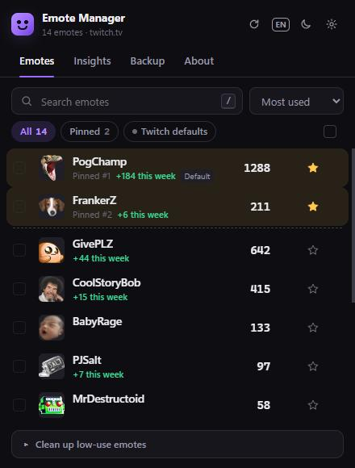
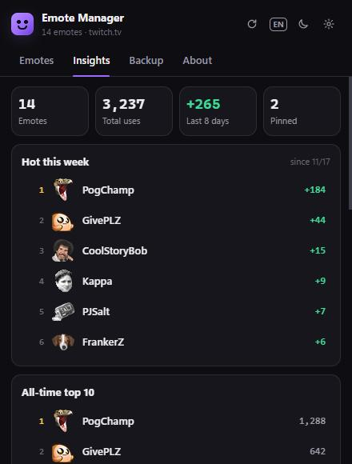
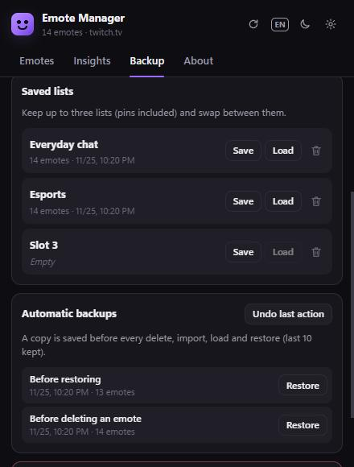

# Twitch Frequently Used Emotes Manager

**Chrome extension: Twitch emote history editor**

[繁體中文](README.md) · [Privacy policy](PRIVACY_POLICY.md)

## About

Take control of the "frequently used" emotes Twitch shows in your emote picker. Pin favourites to the top in your own order, fix or reset use counts, see which emotes you're actually using this week, clean out the ones gathering dust, and back everything up — all from a compact popup. English and Traditional Chinese.

The extension works directly on the emote history Twitch keeps in your browser (`localStorage` key `twilight.emote_picker_history`). Nothing leaves your browser.

  
  
  

## What's new in 2.1.0

- **Redesigned popup** — a compact, dark-first layout that fits Chrome's popup (light and auto themes too).
- **Pin order** — move pinned emotes up and down; Twitch's picker follows that order.
- **Usage trends** — "+N this week" on every emote, plus *Hot this week* and *Gathering dust* lists.
- **Automatic backups and undo** — a backup is taken before every delete, import, load or clear (last 10 kept); restore any of them, or hit **Undo** right in the confirmation toast.
- **Safer bulk actions** — select-all and bulk delete only touch emotes you can currently see.
- **Language switch** — English or Traditional Chinese regardless of your browser language (header button or Settings).
- **Saved slots keep your pins**, use counts are edited inline, and there are keyboard shortcuts.

## Install

Install from the [Chrome Web Store](https://chromewebstore.google.com/detail/twitch-frequently-used-em/amjnkamcoflpnldhdnnhegepggeienhl). Microsoft Edge can install it from the Chrome Web Store as well.

## Using it

Click the extension icon **while a twitch.tv tab is open and active**. On any other site the popup shows an "Open Twitch" button instead.

### Emotes tab

| Action | How |
| --- | --- |
| Search | Type in the search box, or press <kbd>/</kbd> from anywhere |
| Sort | Most used, least used, name A–Z / Z–A, or *Hot this week* |
| Filter | **All** / **Pinned**; **Twitch defaults** toggles Kappa, LUL, PogChamp & co. (pinned ones always show) |
| Edit a count | Click the number, type, press <kbd>Enter</kbd> (or <kbd>Esc</kbd> to cancel) |
| Pin / unpin | Click the ☆ star — pinned emotes stay at the top of Twitch's picker |
| Reorder pins | Hover a pinned row and use the ▲ / ▼ arrows |
| Delete one | Hover a row and click the trash icon — then **Undo** in the toast if it was a mistake |
| Select | Tick checkboxes, click a row, or use the header checkbox to select everything visible |
| Bulk actions | With a selection, the bar at the bottom sets a count for all of them or deletes them |
| Clean up | *Clean up low-use emotes* selects or deletes unpinned emotes at or below a use count |

Rows show small tags: `Pinned #n`, a green `+N this week` when the emote gained uses, and `Default` for Twitch's built-in emotes.

### Insights tab

- Totals: emotes, total uses, uses gained recently, pinned count.
- **Hot this week** — the emotes whose count grew most.
- **All-time top 10**.
- **Gathering dust** — emotes whose count hasn't changed in 30 days (shows *Least used* until 30 days of data exist).
- **Usage distribution** across 0–10, 11–50, 51–100, 101–500 and 500+ uses.

> **How trends work:** Twitch only stores a running total, not dates. Each time you open the popup, the extension records that day's counts (one snapshot per day, last 60 days, kept only in your browser). "This week" compares today with the snapshot from about 7 days ago, so trends appear from the day after you update to 2.1.0. Editing a count by hand also shows up as a change. You can wipe the snapshots in Settings.

### Backup tab

- **Export** — JSON file, CSV file (with image URLs, opens in Excel), or copy JSON to the clipboard.
- **Import** — from a JSON file or the clipboard. **Replace** makes the import your list; **Merge** adds new emotes and keeps the higher count for ones you have. A preview lists exactly what will be added, removed and changed before anything is written.
- **Saved lists** — three named slots (click a name to rename). Saving stores your list *and* your pins.
- **Automatic backups** — the last 10, with what triggered each; restore any with one click. **Undo last action** restores the newest.
- **Danger zone** — clear the entire history (backed up first, so it can be undone).

### Settings

Click the gear icon in the popup. Changes save automatically.

- Language: auto (follows the browser) / English / 繁體中文. The **A / EN / 中** button in the popup header cycles through the same options.
- Theme: auto / dark / light.
- Hide Twitch's default emotes by default.
- Default import mode: Replace or Merge.
- Reset trend history.

### Keyboard shortcuts

| Key | Action |
| --- | --- |
| <kbd>/</kbd> | Focus search |
| <kbd>Esc</kbd> | Clear search or selection, close a dialog |
| <kbd>Enter</kbd> | Save an edited use count |
| <kbd>1</kbd>–<kbd>4</kbd> | Switch tabs |

## How pinning works

Twitch sorts its "frequently used" row by use count. A pinned emote is written to Twitch with a very large count so it always sorts first, in your order. The real count is kept separately and is what you see and edit in the popup.

If Twitch's history is replaced from outside (another device, a Twitch reset, an old import), the extension fixes things up the next time it opens: pins whose emote is gone are dropped, and pins that lost their boost are restored automatically.

## Troubleshooting

- **"Open a Twitch tab first"** — switch to a twitch.tv tab, then reopen the popup.
- **"Couldn't reach the Twitch tab"** — reload the Twitch tab and try again.
- **Changes don't show in Twitch's emote picker** — reload the Twitch page; Twitch may keep using its old copy until then.
- **Import rejected** — the JSON must be an object whose keys are emote IDs and whose values contain `emote.id`, `emote.token` and `uses`. Invalid entries are skipped and counted in the preview.
- **Something went wrong after an action** — Backup tab → Automatic backups → Restore.

## Disclaimer

**Twitch Frequently Used Emotes Manager** is an unofficial personal project. It is not affiliated with, endorsed by or supported by Twitch. Use it at your own discretion.

## License

[MIT License](LICENSE)

## Support

If you find the extension useful and would like to support its development, you can donate via [OPay](https://payment.opay.tw/Broadcaster/Donate/24F8296772A9D24F2F70E3BB22F5C3E8). Thank you!

## Feedback

Questions, ideas or bugs: open an [issue](https://github.com/darrylych/Twitch-Frequently-Used-Emotes-Manager/issues), join the [Discord server](https://discord.gg/CawUubnPdD), or message [darrylych on Discord](https://discord.com/users/536082876836610058).
