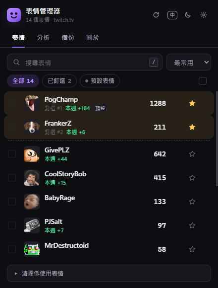
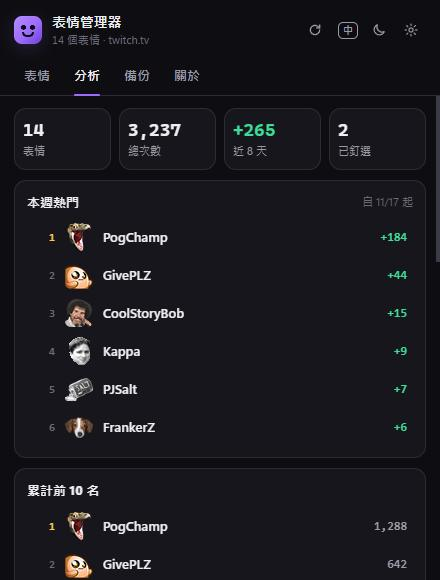
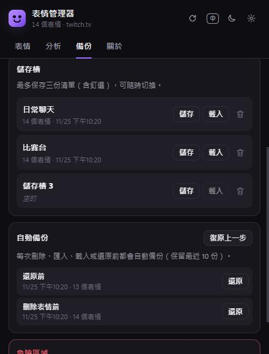

# Twitch Frequently Used Emotes Manager

**Chrome 擴充功能：Twitch 表情符號歷史紀錄編輯器**

[English](README.en.md) · [隱私權政策](PRIVACY_POLICY.md)

## 簡介

掌控 Twitch 表情選單裡的「常用表情」。把喜歡的表情釘選到最上方並自訂順序、修正或重設使用次數、看看這週真正常用哪些表情、清掉久沒用的，還能隨時備份。全部在一個精簡的彈出視窗裡完成，支援繁體中文與英文。

本擴充功能直接讀寫 Twitch 存在你瀏覽器裡的表情歷史紀錄（`localStorage` 的 `twilight.emote_picker_history`），資料不會離開你的瀏覽器。

  
  
  

## 2.1.0 新功能

- **全新介面**：深色優先的精簡版面，完整放進 Chrome 彈窗；也有淺色與跟隨系統主題。
- **自訂釘選順序**：釘選的表情可上下移動，Twitch 表情選單也會照這個順序顯示。
- **使用趨勢**：每個表情都會顯示「本週 +N」，分析頁新增「本週熱門」與「久未使用」。
- **自動備份與復原**：每次刪除、匯入、載入或清除前都會自動備份（保留 10 份），可任選一份還原；刪除後的提示上也能直接按「復原」。
- **更安全的批次操作**：全選與批次刪除只會作用在目前看得到的表情。
- **語言切換**：不論瀏覽器是什麼語言，都可以選擇英文或繁體中文（表頭按鈕或設定頁）。
- **儲存槽會一併保存釘選**、可以直接在列表上修改次數，並新增快速鍵。

## 安裝

從 [Chrome 線上應用程式商店](https://chromewebstore.google.com/detail/twitch-frequently-used-em/amjnkamcoflpnldhdnnhegepggeienhl) 安裝。Microsoft Edge 也可以從 Chrome 線上應用程式商店安裝。

## 使用方式

請**在 twitch.tv 分頁開著並且是目前分頁時**點擊擴充功能圖示。如果目前在其他網站，彈窗會顯示「開啟 Twitch」按鈕。

### 表情分頁

| 動作 | 做法 |
| --- | --- |
| 搜尋 | 在搜尋框輸入，或在任何地方按 <kbd>/</kbd> |
| 排序 | 最常用、最少用、名稱 A–Z / Z–A，或「本週熱門」 |
| 篩選 | 「全部」/「已釘選」；「預設表情」可切換是否顯示 Kappa、LUL、PogChamp 等（已釘選的一定會顯示） |
| 修改次數 | 點數字、輸入後按 <kbd>Enter</kbd>（按 <kbd>Esc</kbd> 取消） |
| 釘選／取消釘選 | 點 ☆ 星號，釘選的表情會固定在 Twitch 選單最上方 |
| 調整釘選順序 | 滑鼠移到釘選列上，使用 ▲ / ▼ 箭頭 |
| 刪除單一表情 | 滑鼠移到該列上點垃圾桶；刪錯了可按提示上的「復原」 |
| 選取 | 勾選方塊、點擊該列，或用上方的勾選框全選目前看得到的表情 |
| 批次操作 | 有選取時，底部的操作列可一次設定次數或刪除 |
| 清理 | 「清理低使用表情」可選取或刪除次數低於門檻的未釘選表情 |

每一列會顯示小標籤：`釘選 #n`、有新增次數時的綠色 `本週 +N`，以及 Twitch 內建表情的 `預設`。

### 分析分頁

- 統計：表情數、總次數、近期新增次數、已釘選數量。
- **本週熱門**：次數增加最多的表情。
- **累計前 10 名**。
- **久未使用**：30 天內次數沒有變化的表情（資料未滿 30 天前會先顯示「最少使用」）。
- **次數分佈**：0–10、11–50、51–100、101–500、500 次以上。

> **趨勢怎麼算：** Twitch 只記錄累計次數，沒有日期。每次開啟彈窗時，擴充功能會記下當天的次數（每天一份、保留 60 天，只存在你的瀏覽器裡）。「本週」是拿今天和大約 7 天前的紀錄相比，所以更新到 2.1.0 後的隔天才會開始有趨勢。手動修改次數也會被算成變化。可以在設定頁清除這些紀錄。

### 備份分頁

- **匯出**：JSON 檔、CSV 檔（含圖片網址，可用 Excel 開啟），或複製 JSON 到剪貼簿。
- **匯入**：從 JSON 檔或剪貼簿。可選「覆蓋」（以匯入的清單取代）或「合併」（加入新表情，已有的保留較高次數）。寫入前會先顯示預覽，列出會新增、移除和變更的項目。
- **儲存槽**：三個可命名的槽位（點名稱即可重新命名），儲存時會連同釘選一起保存。
- **自動備份**：列出最近 10 份備份與觸發原因，點一下即可還原；「復原上一步」會還原最新一份。
- **危險區域**：清除整份歷史紀錄（會先備份，可以復原）。

### 設定頁

點彈窗右上角的齒輪圖示。變更會自動儲存。

- 語言：自動（跟隨瀏覽器）／English／繁體中文。彈窗表頭的 **A / EN / 中** 按鈕也可以直接切換。
- 主題：自動／深色／淺色。
- 預設隱藏 Twitch 預設表情。
- 預設匯入模式：覆蓋或合併。
- 重設趨勢紀錄。

### 快速鍵

| 按鍵 | 功能 |
| --- | --- |
| <kbd>/</kbd> | 跳到搜尋框 |
| <kbd>Esc</kbd> | 清除搜尋或選取、關閉對話框 |
| <kbd>Enter</kbd> | 儲存修改的次數 |
| <kbd>1</kbd>–<kbd>4</kbd> | 切換分頁 |

## 釘選的原理

Twitch 依使用次數排序「常用表情」。釘選的表情會以一個很大的次數寫入 Twitch，所以會依你設定的順序永遠排在最前面；真實次數另外保存，彈窗裡看到和修改的都是真實次數。

如果 Twitch 的歷史紀錄被外部取代（其他裝置、Twitch 重設、舊版匯入），下次開啟彈窗時會自動處理：表情已不存在的釘選會被移除，失去置頂效果的釘選會自動補回。

## 疑難排解

- **「請先切換到 Twitch 分頁」**：切到 twitch.tv 分頁後再開啟彈窗。
- **「無法連線到 Twitch 分頁」**：重新整理 Twitch 分頁後再試一次。
- **Twitch 表情選單沒有變化**：重新整理 Twitch 頁面；在那之前 Twitch 可能仍使用舊資料。
- **匯入被拒絕**：JSON 必須是物件，鍵為表情 ID，值需包含 `emote.id`、`emote.token` 與 `uses`。無效的項目會被略過，並顯示在預覽中。
- **操作後發現資料不對**：到「備份」分頁 →「自動備份」→「還原」。

## 注意事項

**Twitch Frequently Used Emotes Manager** 是一個非官方的個人專案，與 Twitch 公司沒有任何關聯，也不受 Twitch 官方認可或支援。使用本擴充功能可能存在風險，請自行評估是否使用。

## 授權條款

[MIT License](LICENSE)

## 贊助 / Donate

如果您覺得這個擴充功能對您有幫助，並且願意支持我的開發工作，歡迎透過 [歐付寶 (oPay)](https://payment.opay.tw/Broadcaster/Donate/24F8296772A9D24F2F70E3BB22F5C3E8) 贊助。非常感謝您的支持！

## 意見回饋

有任何問題、建議或發現 Bug，歡迎提出 [Issue](https://github.com/darrylych/Twitch-Frequently-Used-Emotes-Manager/issues)、加入 [Discord 伺服器](https://discord.gg/CawUubnPdD)，或透過 [Discord (darrylych)](https://discord.com/users/536082876836610058) 聯絡我。
