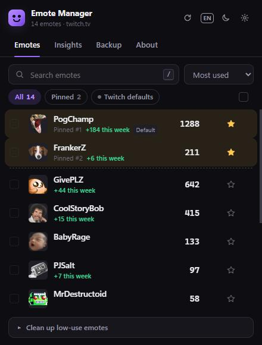
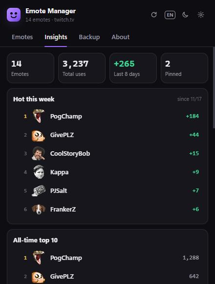
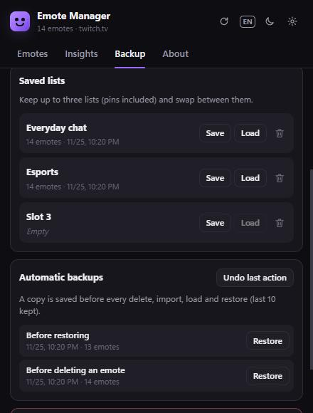

# Twitch Frequently Used Emotes Manager — User Guide

[繁體中文教學](./) · [Privacy policy](PRIVACY_POLICY.html) · [GitHub](https://github.com/darrylych/Twitch-Frequently-Used-Emotes-Manager)

Twitch fills the "frequently used" row of its emote picker by use count. This extension lets you decide what goes there: pin favourites to the front, change or reset use counts, see which emotes you're actually using this week, clear out the ones gathering dust, and back everything up.

This guide covers **version 2.1.0**.

---

## Contents

1. [Install and open](#install)
2. [Pin emotes to the front](#pin)
3. [Change a use count](#edit)
4. [Search, sort and filter](#search)
5. [Work with many emotes at once](#bulk)
6. [See what you've been using](#insights)
7. [Back up, restore and switch lists](#backup)
8. [Settings](#settings)
9. [Keyboard shortcuts](#shortcuts)
10. [FAQ](#faq)

---

## 1. Install and open {#install}

1. Open the [Chrome Web Store page](https://chromewebstore.google.com/detail/twitch-frequently-used-em/amjnkamcoflpnldhdnnhegepggeienhl) and click **Add to Chrome** → **Add extension**. Microsoft Edge can install from the same page.
2. Pin the extension to your toolbar: click the puzzle-piece icon next to the address bar, then the pin next to the extension.

   

3. Open any [Twitch](https://www.twitch.tv) page and, **with the Twitch tab active**, click the extension icon.

On any other site the popup shows **"Open a Twitch tab first"** and an *Open Twitch* button.

The interface follows your browser language by default. To use English or Traditional Chinese regardless, click the **A / EN / 中** button in the popup's top-right corner (see [Settings](#settings)).

> An empty list means Twitch hasn't recorded any emotes for you yet. Use a few in chat, then click ⟳ in the popup's top-right corner to reload.

## 2. Pin emotes to the front {#pin}

This is the main feature: keep the emotes you want at the front of Twitch's emote picker.

1. Find the emote in the **Emotes** tab.
2. Click the **☆ star** on its row. A gold star means it's pinned; pinned emotes move to the top of the list and are labelled *Pinned #1*, *Pinned #2*…
3. **Reorder:** hover a pinned row and use the ▲ / ▼ arrows on the right. Twitch's picker follows this order.
4. Click the gold star again to unpin; the emote goes back to its real use count.

> After making changes, **reload the Twitch page** so its emote picker picks up the new order.

**Tip:** Twitch's default emotes (Kappa, LUL, PogChamp…) are hidden by default. To pin one, click **Twitch defaults** to show them first — once pinned, it stays visible even when defaults are hidden.

## 3. Change a use count {#edit}

1. Click the number on the right of an emote.
2. Type a new count and press <kbd>Enter</kbd> to save, or <kbd>Esc</kbd> to cancel.
3. The number briefly flashes green when it's saved.

Pinned emotes can be edited too. You always see and edit the real count, and that's what the emote returns to when unpinned.

## 4. Search, sort and filter {#search}

- **Search:** type in the search box, or press <kbd>/</kbd> from anywhere to jump to it. <kbd>Esc</kbd> clears it.
- **Sort:** use the menu at the top right — most used, least used, name A–Z / Z–A, or *Hot this week*. Pinned emotes always come first.
- **Filter:** **All** or **Pinned**; **Twitch defaults** shows or hides Twitch's built-in emotes.

## 5. Work with many emotes at once {#bulk}

### Bulk edit or delete

1. Tick the checkbox on the left of an emote, or click its row. The checkbox at the top right **selects everything currently visible**.
2. With a selection, a bar appears at the bottom showing how many are selected:
   - Type a number and click **Set** to give all of them that count.
   - Click **Delete** and confirm to remove them.
3. Click ✕ or press <kbd>Esc</kbd> to clear the selection.

Select-all only picks **emotes you can currently see**. Emotes hidden by a search or filter are never selected or deleted.

### Clean up low-use emotes

1. Expand **Clean up low-use emotes** below the list.
2. Enter a threshold, e.g. `5` for emotes used 5 times or fewer.
3. Click **Select** to preview which ones match, or **Delete all** to remove them.

Pinned emotes are never included.

### Deleted something by mistake?

After every delete a message appears at the bottom — click **Undo** on it. If it's gone, restore from the Backup tab (see [section 7](#backup)).

## 6. See what you've been using {#insights}

The **Insights** tab shows:

- **Totals:** emotes, total uses, uses gained recently, and pinned emotes.
- **Hot this week:** the emotes whose count grew the most.
- **All-time top 10.**
- **Gathering dust:** emotes whose count hasn't changed in 30 days — good candidates for cleaning up.
- **Usage distribution:** how many emotes fall into each use-count range.

In the Emotes tab, recently used emotes also show a green **+N this week**.

> **Why are there no trends at first?** Twitch only stores a running total, not dates. The extension records that day's counts each time you open the popup, so "this week" numbers appear from **the day after** you start using 2.1.0, and "Gathering dust" needs 30 days. These records stay in your browser and can be cleared in Settings.

## 7. Back up, restore and switch lists {#backup}

### Automatic backups

Before every delete, bulk edit, clean-up, import, slot load, clear and restore, the extension **backs up your list automatically** and keeps the last 10.

- In the **Backup** tab under **Automatic backups**, each backup shows when it was made, how many emotes it holds and what triggered it. Click **Restore** to go back to it.
- **Undo last action** restores the newest backup.

### Saved lists: switch between setups

Handy if you use different emotes for, say, chatting and watching esports.

1. Click the name "Slot 1" to rename it, e.g. "Everyday".
2. Click **Save** to store the current list (pins included).
3. Later, click **Load** to switch to it. Your current list is backed up first, so nothing is lost.

### Export and import

- **Export** as a JSON file (for backups or moving to another computer), a CSV file (opens in Excel), or copy the JSON to the clipboard.
- **Import** from a JSON file or the clipboard. Pick a mode first:
  - **Replace:** the imported list replaces yours.
  - **Merge:** new emotes are added; for emotes in both, the higher count is kept.
- A **preview** lists what will be added, removed and changed before anything is written.

### Clear everything

**Clear history** in the *Danger zone* deletes Twitch's entire emote history. It's backed up first, so it can still be undone.

## 8. Settings {#settings}

Click the ⚙ gear in the popup's top-right corner. Settings save automatically:

- **Language:** auto (follows your browser), English or 繁體中文. The **A / EN / 中** button in the popup header switches it too.
- **Theme:** auto (follows your system), dark or light. You can also switch with the moon/sun icon in the popup header.
- **Hide Twitch's default emotes** when the popup opens.
- **Default import mode:** Replace or Merge.
- **Reset trend history:** delete the daily records used for "this week" and "gathering dust".

## 9. Keyboard shortcuts {#shortcuts}

| Key | Action |
| --- | --- |
| <kbd>/</kbd> | Focus search |
| <kbd>Esc</kbd> | Clear search or selection, close a dialog |
| <kbd>Enter</kbd> | Save an edited use count |
| <kbd>1</kbd>–<kbd>4</kbd> | Switch to the Emotes / Insights / Backup / About tab |

## 10. FAQ {#faq}

**I made changes but Twitch's emote picker looks the same.**
Reload the Twitch page — until then Twitch may keep using its old copy.

**It says "Couldn't reach the Twitch tab".**
Reload the Twitch tab and open the popup again.

**My list is different on another computer or browser.**
Twitch keeps the emote history separately in each browser. Use *Export JSON* on one machine and *Import* on the other. Preferences and pins sync through Chrome sync.

**My pinned emotes aren't at the front any more.**
If Twitch's history was reset by another device or by Twitch itself, the extension restores your pins the next time you open the popup. Open it, then reload the Twitch page.

**Import says the format is wrong.**
The file must be a JSON export from this extension, or something with the same shape. Invalid entries are skipped and counted in the preview.

**Something looks wrong after an action.**
Go to Backup → Automatic backups and restore the one from before the action.

---

## Notes

- The extension only reads and writes `twilight.emote_picker_history`, which Twitch stores in your browser. Your data stays on your computer and is never uploaded — see the [privacy policy](PRIVACY_POLICY.html).
- **Twitch Frequently Used Emotes Manager** is an unofficial personal project. It is not affiliated with, endorsed by or supported by Twitch. Use it at your own discretion.

## License

[MIT License](https://github.com/darrylych/Twitch-Frequently-Used-Emotes-Manager/blob/main/LICENSE)

## Support

If the extension helps you and you'd like to support its development:

* **OPay:** [donate via OPay](https://payment.opay.tw/Broadcaster/Donate/24F8296772A9D24F2F70E3BB22F5C3E8)
* **ECPay:** [donate via ECPay](https://p.ecpay.com.tw/E1B34)

Thank you!

## Feedback

Questions, ideas or bugs: open an issue on [GitHub](https://github.com/darrylych/Twitch-Frequently-Used-Emotes-Manager/issues), join the [Discord server](https://discord.gg/CawUubnPdD), or message [darrylych on Discord](https://discord.com/users/536082876836610058).
