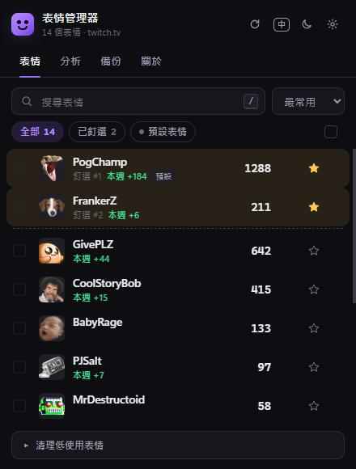
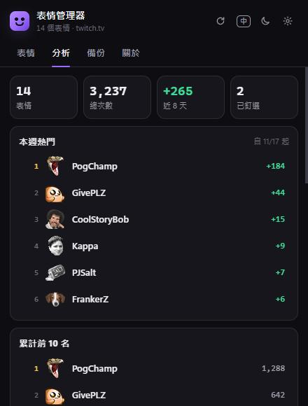
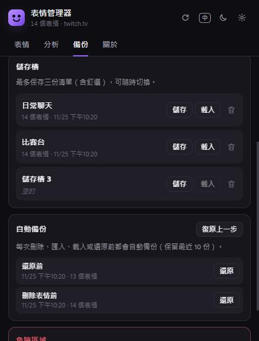

# Twitch Frequently Used Emotes Manager 使用教學

[English guide](en.html) · [隱私權政策](PRIVACY_POLICY.html) · [GitHub](https://github.com/darrylych/Twitch-Frequently-Used-Emotes-Manager)

Twitch 會依照使用次數，把你最常用的表情排在表情選單的「常用」區。這個擴充功能讓你可以自己決定那一排要放什麼：把喜歡的表情釘在最前面、修改或歸零使用次數、看看這週真正常用哪些表情、清掉久沒用的，並隨時備份與還原。

本頁說明適用於 **2.1.0 版**。

---

## 目錄

1. [安裝與開啟](#install)
2. [把表情釘在最前面](#pin)
3. [修改使用次數](#edit)
4. [搜尋、排序與篩選](#search)
5. [一次處理很多表情](#bulk)
6. [看看自己最近常用什麼](#insights)
7. [備份、還原與切換清單](#backup)
8. [設定](#settings)
9. [快速鍵](#shortcuts)
10. [常見問題](#faq)

---

## 1. 安裝與開啟 {#install}

1. 到 [Chrome 線上應用程式商店](https://chromewebstore.google.com/detail/twitch-frequently-used-em/amjnkamcoflpnldhdnnhegepggeienhl)，點「**加到 Chrome**」→「**新增擴充功能**」。Microsoft Edge 也可以從同一個頁面安裝。
2. 建議把擴充功能釘選到工具列：點網址列右側的拼圖圖示，再點本擴充功能旁的圖釘。

   

3. 打開任一個 [Twitch](https://www.twitch.tv) 頁面，**在 Twitch 分頁是目前分頁時**點擴充功能圖示。

如果目前不在 Twitch 分頁，彈窗會顯示「**請先切換到 Twitch 分頁**」和「開啟 Twitch」按鈕。

介面語言預設跟隨瀏覽器。想換成英文或繁體中文，點彈窗右上角的 **A / EN / 中** 按鈕即可切換（詳見[設定](#settings)）。

> 如果清單是空的，表示 Twitch 還沒有你的表情紀錄。先在聊天室用幾個表情，再按彈窗右上角的 ⟳ 重新載入。

## 2. 把表情釘在最前面 {#pin}

這是最常用的功能：讓你想要的表情永遠排在 Twitch 表情選單的最前面。

1. 在「**表情**」分頁找到想要的表情。
2. 點那一列右邊的 **☆ 星號**，星號變成金色就代表已釘選。釘選的表情會移到列表最上方，並標示「釘選 #1」、「釘選 #2」……
3. **調整順序**：把滑鼠移到釘選的那一列，右側會出現 ▲ / ▼，點一下就能上移或下移。Twitch 表情選單會照這個順序顯示。
4. 再點一次金色星號即可取消釘選，表情會回到原本的使用次數。

> 修改完成後，請**重新整理 Twitch 頁面**，Twitch 的表情選單才會換成新的順序。

**小提醒：** Twitch 的預設表情（Kappa、LUL、PogChamp 等）預設是隱藏的。想釘選它們，先點上方的「**預設表情**」把它們顯示出來；釘選之後就算再隱藏，它們也會一直顯示。

## 3. 修改使用次數 {#edit}

1. 直接點表情右邊的數字。
2. 輸入新的次數，按 <kbd>Enter</kbd> 儲存；按 <kbd>Esc</kbd> 則取消修改。
3. 儲存成功時，數字會短暫閃一下綠色。

釘選中的表情也可以修改次數。你看到和修改的都是真實次數，取消釘選後就會恢復成這個數字。

## 4. 搜尋、排序與篩選 {#search}

- **搜尋**：在搜尋框輸入名稱，或在任何地方按 <kbd>/</kbd> 直接跳到搜尋框。按 <kbd>Esc</kbd> 清除搜尋。
- **排序**：用右上角的選單切換「最常用」、「最少用」、「名稱 A–Z / Z–A」或「本週熱門」。釘選的表情永遠排在最前面。
- **篩選**：點「**全部**」或「**已釘選**」；「**預設表情**」可以切換是否顯示 Twitch 預設表情。

## 5. 一次處理很多表情 {#bulk}

### 批次修改或刪除

1. 勾選表情左邊的方塊，或直接點表情那一列。也可以用右上角的勾選框，**全選目前看得到的表情**。
2. 有選取時，底部會出現操作列，顯示「已選 N 個」：
   - 在「次數」欄輸入數字後按「**設定**」，所有選取的表情都會改成這個次數。
   - 按「**刪除**」並確認，就會刪除選取的表情。
3. 點 ✕ 或按 <kbd>Esc</kbd> 取消選取。

全選只會選到**目前畫面上看得到的表情**。被搜尋或篩選隱藏的表情不會被選到，也不會被刪除。

### 清理低使用表情

1. 展開列表下方的「**清理低使用表情**」。
2. 輸入門檻，例如 `5`，代表次數 ≤ 5 的表情。
3. 按「**選取**」先看看會選到哪些表情；或直接按「**全部刪除**」。

已釘選的表情永遠不會被清理。

### 刪錯了怎麼辦？

每次刪除後，畫面下方都會出現提示，按提示上的「**復原**」就能還原。提示消失後，也可以到「備份」分頁還原（見[第 7 節](#backup)）。

## 6. 看看自己最近常用什麼 {#insights}

切到「**分析**」分頁，可以看到：

- **統計**：表情數、總次數、近期新增的次數，以及已釘選數量。
- **本週熱門**：這週次數增加最多的表情。
- **累計前 10 名**。
- **久未使用**：30 天內次數完全沒有變化的表情，很適合拿來清理。
- **次數分佈**：各個次數區間各有幾個表情。

在「表情」分頁，最近有用到的表情也會顯示綠色的「**本週 +N**」。

> **為什麼一開始沒有趨勢？** Twitch 只記錄累計次數，沒有日期。擴充功能會在你每次開啟彈窗時記下當天的次數，所以**第一次使用的隔天**才會開始出現「本週」的數字；「久未使用」則需要累積 30 天。這些紀錄只存在你的瀏覽器裡，可以在設定頁清除。

## 7. 備份、還原與切換清單 {#backup}

### 自動備份

在刪除、批次修改、清理、匯入、載入儲存槽、清除與還原之前，擴充功能都會**自動備份**，保留最近 10 份。

- 在「**備份**」分頁的「**自動備份**」區，可以看到每一份備份的時間、表情數量和觸發原因，按「**還原**」即可回到那個狀態。
- 「**復原上一步**」會還原最新的一份備份。

### 儲存槽：在不同清單之間切換

例如你可以在聊天和看比賽時使用不同的常用表情。

1. 點「儲存槽 1」的名稱就能重新命名，例如改成「日常聊天」。
2. 按「**儲存**」，把目前的清單（包含釘選）存進去。
3. 之後想切換時，按「**載入**」。目前的清單會先自動備份，所以不用擔心被覆蓋。

### 匯出與匯入

- **匯出**：可以存成 JSON 檔（用來備份或搬到其他電腦）、CSV 檔（可用 Excel 開啟），或複製 JSON 到剪貼簿。
- **匯入**：從 JSON 檔或剪貼簿匯入。先選擇模式：
  - **覆蓋**：用匯入的清單取代目前的清單。
  - **合併**：加入新的表情；兩邊都有的表情保留較高的次數。
- 匯入前會先顯示**預覽**，列出會新增、移除和變更哪些表情，確認後才會寫入。

### 清除全部

「危險區域」的「**清除清單**」會刪除 Twitch 的整份表情紀錄。清除前同樣會自動備份，所以仍然可以復原。

## 8. 設定 {#settings}

點彈窗右上角的 ⚙ 齒輪圖示。所有設定都會自動儲存：

- **語言**：自動（跟隨瀏覽器）、English 或繁體中文。也可以直接點彈窗右上角的 **A / EN / 中** 按鈕切換。
- **主題**：自動（跟隨系統）、深色或淺色。也可以直接點彈窗右上角的月亮／太陽圖示切換。
- **隱藏 Twitch 預設表情**：每次開啟時是否預設隱藏。
- **預設匯入模式**：覆蓋或合併。
- **重設趨勢紀錄**：刪除用來計算「本週」和「久未使用」的每日紀錄。

## 9. 快速鍵 {#shortcuts}

| 按鍵 | 功能 |
| --- | --- |
| <kbd>/</kbd> | 跳到搜尋框 |
| <kbd>Esc</kbd> | 清除搜尋或選取、關閉對話框 |
| <kbd>Enter</kbd> | 儲存修改的次數 |
| <kbd>1</kbd>–<kbd>4</kbd> | 切換到 表情／分析／備份／關於 分頁 |

## 10. 常見問題 {#faq}

**改完之後，Twitch 的表情選單沒有變？**
請重新整理 Twitch 頁面。在那之前，Twitch 可能還在使用舊的資料。

**顯示「無法連線到 Twitch 分頁」？**
重新整理 Twitch 分頁，再重新開啟彈窗。

**在別的電腦或瀏覽器上，清單不一樣？**
表情紀錄是 Twitch 存在每個瀏覽器裡的，不同電腦本來就不同。可以先在一台電腦上「匯出 JSON」，再到另一台「匯入」。偏好設定和釘選清單會透過 Chrome 同步。

**釘選的表情不在最前面了？**
如果 Twitch 的紀錄被其他裝置或 Twitch 本身重設，下次開啟彈窗時，擴充功能會自動補回釘選。開啟彈窗後再重新整理 Twitch 頁面即可。

**匯入時顯示格式錯誤？**
檔案必須是本擴充功能匯出的 JSON，或結構相同的檔案。格式不對的項目會被略過，並顯示在預覽中。

**操作後發現資料不對？**
到「備份」分頁 →「自動備份」，選擇操作前的那一份按「還原」。

---

## 注意事項

- 本擴充功能只讀寫 Twitch 存在你瀏覽器裡的 `twilight.emote_picker_history`。所有資料都留在你的電腦上，不會上傳到任何伺服器，詳見[隱私權政策](PRIVACY_POLICY.html)。
- **Twitch Frequently Used Emotes Manager** 是一個非官方的個人專案，與 Twitch 公司沒有任何關聯，也不受 Twitch 官方認可或支援。使用本擴充功能可能存在風險，請自行評估是否使用。

## 授權條款

[MIT License](https://github.com/darrylych/Twitch-Frequently-Used-Emotes-Manager/blob/main/LICENSE)

## 贊助 / Donate

如果您覺得這個擴充功能對您有幫助，並且願意支持我的開發工作，非常歡迎您透過以下連結贊助我：

* **歐付寶 (oPay)：** [贊助連結（歐付寶）](https://payment.opay.tw/Broadcaster/Donate/24F8296772A9D24F2F70E3BB22F5C3E8)
* **綠界科技 (ECPay)：** [贊助連結（綠界科技）](https://p.ecpay.com.tw/E1B34)

您的贊助是對我最大的鼓勵，非常感謝您的支持！

## 意見回饋

有任何問題、建議或發現 Bug，歡迎到 [GitHub Issues](https://github.com/darrylych/Twitch-Frequently-Used-Emotes-Manager/issues) 回報，或加入 [Discord 伺服器](https://discord.gg/CawUubnPdD)、透過 [Discord (darrylych)](https://discord.com/users/536082876836610058) 聯絡我。
